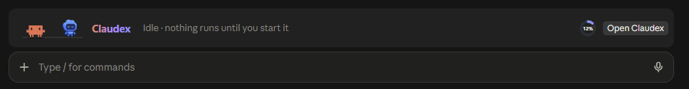
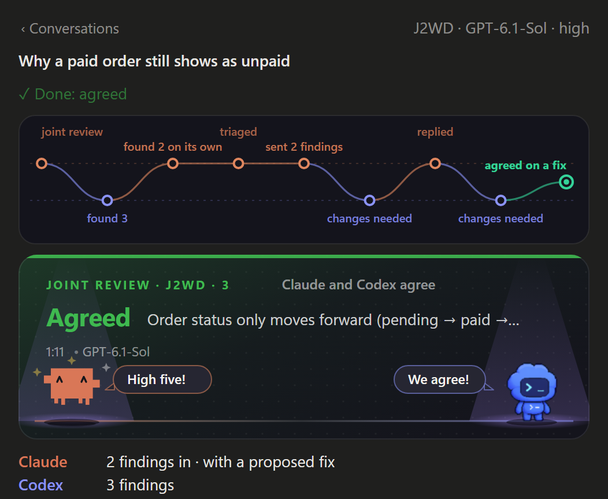
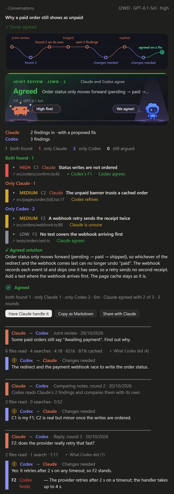

<div align="center">

# Claudex

**Claude and Codex, working together from Claude Code.**

Reviews and second opinions, tasks in their own worktree, build loops, shared jobs and pictures:<br>
Codex on your ChatGPT plan, brought into Claude Code, live in the chat.

[](.claude-plugin/plugin.json)
[](https://claude.com/claude-code)
[](https://openai.com/codex)
[](LICENSE)
[](#requirements)
[](https://nodejs.org)

[What it does](#what-it-does) · [Conversations](#every-conversation-in-full) · [Examples](#examples) · [Install](#install) · [Settings](#settings) · [FAQ](#faq)

<br>



</div>

> [!NOTE]
> Claudex is an unofficial community mod. It isn't made by, endorsed by, or affiliated with
> Anthropic or OpenAI. "Claude" and "Clawd" belong to Anthropic; "Codex" and "ChatGPT" belong
> to OpenAI.

## What it does

You talk to Claude as usual. When you want a second pair of eyes or a second pair of hands,
ask Claude to bring in Codex. You can watch the two of them work together on a little
stage above the prompt.

<table>
<tr>
<td width="50%" valign="top">

### 🔍 Reviews and second opinions
Codex reviews your uncommitted changes, a branch, a commit or specific files, with a focus
on **correctness, security, performance, tests, simplicity or UX**. Claude checks each finding
and marks whether it *agrees*, *disagrees* or is *unsure*, and you see both views side by side.

</td>
<td width="50%" valign="top">

### 🤝 Joint reviews
Claude and Codex each review **on their own**, without seeing the other's findings. Then
they compare notes, argue out where they disagree, and agree on one solution.

</td>
</tr>
<tr>
<td valign="top">

### 🛠️ Tasks in their own worktree
Codex builds in **its own copy of the repo**, so nothing touches your files until Claude has
reviewed the diff and applies it, in whole or file by file. Every apply can be undone in one click.

</td>
<td valign="top">

### 🔁 Build loops and shared jobs
Claude builds, Codex reviews, Claude fixes, Codex rechecks, **until Codex approves**. For
bigger jobs, Claude splits the work between them and tracks it on one board.

</td>
</tr>
<tr>
<td valign="top">

### 💬 A two-way line
While Codex works, you or Claude can **steer it now** or **queue notes for its next round**.
Codex can tell Claude what it finds, or ask a question and either wait or carry on.

</td>
<td valign="top">

### 🎨 Pictures
Codex's image model paints PNGs, up to four variations at once. **Cut-outs come with a real
transparent background** (an alpha channel) straight from Codex; if its image tool can't do
that, it paints on flat magenta and Claudex keys it out for you. It also paints empty backdrops
("plates") and edits pictures you give it.

</td>
</tr>
<tr>
<td valign="top">

### ✅ Fixes checked, not assumed
Applying a fix leaves its findings open, marked **fix applied**, until Claude or a Codex
recheck confirms them. One tap closes them if you checked yourself.

</td>
<td valign="top">

### 🧭 Plans, bugs, visual reviews and Codex's browser
Codex checks plans before you build, hunts bugs from a log, and reviews desktop and phone
screenshots of a page. When it wants to open a site in its own browser, you choose
**Allow once**, **Always allow** or **Deny**.

</td>
</tr>
</table>

Codex only runs when you ask for it. Claude never calls it on its own initiative.

## See it

<div align="center">



<sub><b>Always there, never in the way.</b> At rest, the band sits above the prompt with your Codex usage and a way into the pane. Nothing runs until you start it.</sub>

<br><br>



<sub><b>A question mid-run.</b> Codex asks Claude something. It either waits for the answer or carries on with what doesn't depend on it.</sub>

<br><br>



<sub><b>A review lands.</b> Codex's findings drop onto the stage in their severity colours, and the two trade a line about them.</sub>

<br><br>



<sub><b>Claude's turn.</b> Codex built the task in its own worktree; Claude checks the diff before anything reaches your files.</sub>

<br><br>



<sub><b>Approved.</b> The recheck closes the loop.</sub>

<br><br>



<sub><b>The Claudex pane</b> (<code>/claudex</code>): every conversation, task, job and picture, plus your Codex usage, with the stage on top.</sub>

</div>

The same scenes show up as live cards in the chat. Motion is up to you: **Calm** (the default)
moves when something happens and then rests, **Full** keeps moving, and **Still** stops all
motion except the clocks.

## Every conversation, in full

Open any conversation in the pane (`/claudex`, then a row under **Talk** or **Tasks**) to see
the whole thing: what was asked, what each side found, how they argued, and what they settled on.

<div align="center">



<details>
<summary><b>See the whole conversation</b> (a tall picture)</summary>
<br>

</details>

</div>

From top to bottom:

- **The timeline.** Every move, drawn as a path between two lanes: Claude's on top, Codex's
  below. You see who did what, in order: found 3, triaged, sent 2 findings, replied, agreed on a fix.
- **How it ended**, on the stage: approved, changes needed or, in a joint review, agreed.
- **The findings.** A joint review groups them by who found them: *both found*, *only Claude*,
  *only Codex* and *still argued*. Each one shows its severity, a link that opens the file at the
  line, and what the other side made of it (*agrees*, *refines*, *is unsure*). Tap ▸ to open one:
  its detail, the suggested fix, the replies from each round, and buttons to have Claude or Codex
  fix it, or to dismiss it.
- **The agreed solution** in full, and what to do next: **Have Claude handle it**,
  **Copy as Markdown** or **Share with Claude**.
- **Every round, in order.** What Claude sent and what Codex answered, the files it read, the
  searches it ran, how long it took, and its tokens (and how many were cached). **What Codex did**
  lists each step. Where Claude disputed a finding, Codex's answer says whether it *holds*,
  *concedes* or *refines* it.

While a round runs, the same page shows it live: send Codex a note now, queue one for its next
round, or answer a question it asked. A task's page shows each file it changed with its diff,
and an **Undo** once it's applied.

## Examples

There are no commands to learn. You just tell Claude what you want, in your own words.

<details open>
<summary><b>A second opinion before you commit</b></summary>

```text
Ask Codex to review my uncommitted changes, especially for security.
```

Codex returns findings (`F1`, `F2`, …). Claude checks each one against the code and marks it
*agree*, *disagree* or *unsure* with a note. Then it fixes what's real, and Codex rechecks.
</details>

<details>
<summary><b>Let them argue it out</b></summary>

```text
Do a joint review of this branch against main with Codex.
```

Claude writes its own findings while Codex writes its own. Neither sees the other's until
both are done. Then they compare, debate the points they disagree on, and agree on one solution.
</details>

<details>
<summary><b>Check a plan before building it</b></summary>

```text
Before you start, have Codex look over the plan.
```

Claude weighs each of Codex's points and gives you the revised plan with a short "Codex review" section.
</details>

<details>
<summary><b>Hand off a piece of work</b></summary>

```text
Have Codex add pagination to the orders API. Done means the tests pass
and the page size is configurable.
```

Codex works in its own git worktree, so your files stay untouched. When it finishes, Claude
reviews the patch like a colleague's. It then applies the patch, applies only some files,
sends it back with notes, or throws it away.
</details>

<details>
<summary><b>Build until it's approved</b></summary>

```text
Build the settings page, and loop with Codex reviewing until it approves.
```
</details>

<details>
<summary><b>Find a bug</b></summary>

```text
Codex, why does `npm test` fail on CI but pass locally? Here's the log: …
```
</details>

<details>
<summary><b>Check how a page looks</b></summary>

```text
Have Codex do a visual review of http://localhost:3000/pricing compared with the live site.
```
</details>

<details>
<summary><b>Steer it mid-run</b></summary>

```text
Tell Codex the API moved to src/api/v2, and that it should use that.
When it's done, queue up a note for Codex to also add tests.
```
</details>

<details>
<summary><b>Paint a picture</b></summary>

```text
Ask Codex for three variations of a cosy pixel-art kitchen, wide format.
Then paint the chef as a cut-out on a transparent background.
```
</details>

<details>
<summary><b>Stop everything</b></summary>

```text
Stop Codex.
```
</details>

## Requirements

| Needs | Details |
|---|---|
| **Claude Code** | The desktop app or the terminal |
| **Codex** | Signed in with your ChatGPT account. The Codex desktop app works best, because Claudex uses its CLI. The CLI on its own also works: `npm i -g @openai/codex`, then `codex login` |
| **Node.js** | 20 or newer |
| **git** | Any recent version |

Optional, per project: **Playwright** (`npm i -D playwright`) plus Chrome or Edge for visual
reviews, and **sharp** for WebP copies of pictures. Cut-outs need nothing extra.

## Install

**1. Clone** the repo into your Claude Code mods folder:

```bash
git clone https://github.com/viscolex/claudex.git ~/.claude/mods/claudex
```

**2. Load it.** Add this to `~/.claude/settings.json`, merging it into any `env` block you already have:

```json
{
  "env": {
    "CLAUDE_CODE_PLUGIN_DIRS": "/Users/YOUR-NAME/.claude/mods/claudex"
  }
}
```

On Windows, use `C:\\Users\\YOUR-NAME\\.claude\\mods\\claudex`.

**3. Restart** Claude Code and start a new chat. The Claudex band appears above the prompt after
your first message, and `/claudex` opens the pane.

**4. Check** that it can reach your Codex:

```bash
node ~/.claude/mods/claudex/scripts/smoke.mjs
```

Each check prints `PASS` or `FAIL`. No model runs, so it costs nothing. Add `--turn` to also
run one tiny real turn.

> [!TIP]
> To update later, run `git pull` in `~/.claude/mods/claudex` and restart Claude Code.
> [INSTALL.md](INSTALL.md) covers upgrading from the older Codex mod and where Claudex keeps its
> files.

## Settings

Open **Usage & settings** in the Claudex pane, or the mod's settings in Claude Code:

| Setting | Options | Default |
|---|---|---|
| Codex model | Any model your Codex offers | `gpt-6.1-sol` |
| Reasoning effort | `low` · `medium` · `high` · `xhigh` · `max` · `ultra` | `high` |
| Motion | Calm · Full · Still | Calm |

Codex runs use your own Codex quota. Claudex shows your usage, and warns you before starting
work once you're above 90%.

## FAQ

<details>
<summary><b>Does Codex ever change my files on its own?</b></summary>

No. In a conversation, Codex's shell is read-only. Tasks run in a separate git worktree, and
nothing reaches your files until Claude reviews the diff and applies it. Every apply can be undone.
</details>

<details>
<summary><b>What does it cost?</b></summary>

Claudex is free. Codex runs on your own ChatGPT plan's Codex quota, and the smoke test uses none.
</details>

<details>
<summary><b>Where is the Codex mascot from?</b></summary>

The Codex companion on the stage is cut from the Codex desktop app's own artwork on your
computer, so it always matches your installed version. The mod doesn't ship that artwork
itself (it appears here only in the README pictures). With only the Codex CLI installed,
everything still works; the stage just shows Claude's side without the mascot.
</details>

<details>
<summary><b>Something's off after a Codex update</b></summary>

Run `node scripts/smoke.mjs` from the mod folder; the `FAIL` lines say what changed. See
[INSTALL.md](INSTALL.md#if-somethings-off) for more fixes.
</details>

## Project layout

```text
.claude-plugin/plugin.json   mod manifest and settings
hooks/register.tsx           the mod: tools, cards, band, pane
hooks/art.ts, duet.ts        the stage and its drawings
scripts/                     Node helpers: Codex app server, tasks, worktrees, images, smoke test
schemas/                     JSON schemas for Codex's structured replies
types/index.d.ts             the mod API types
tests/                       tests, run with Claude Code's mod test runner
docs/images/                 README images: the SVGs are drawn by hooks/duet.ts, the PNGs are the pane
```

## License

[MIT](LICENSE) © Andrej Safranovic
